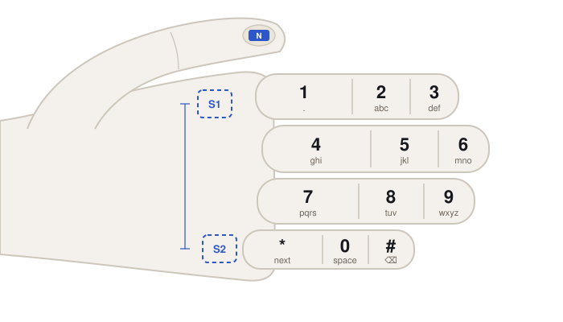
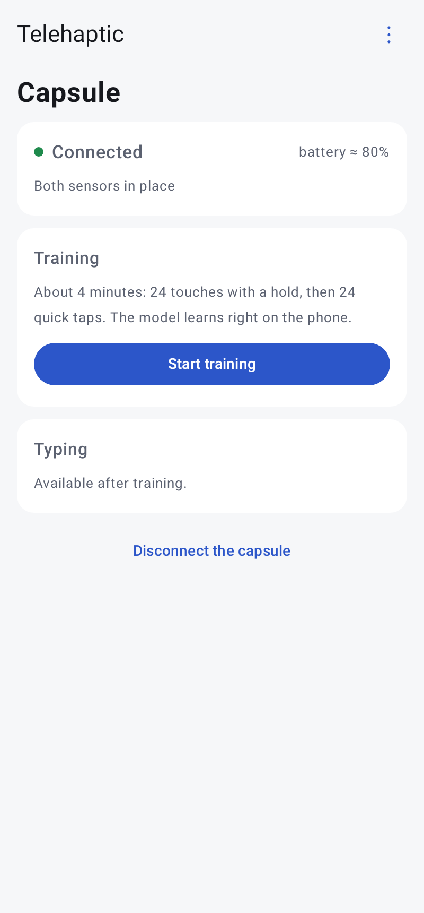
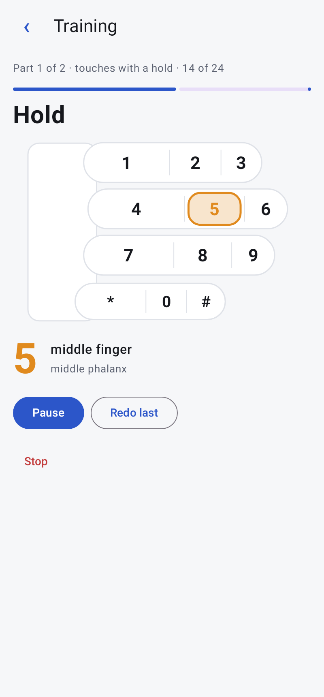
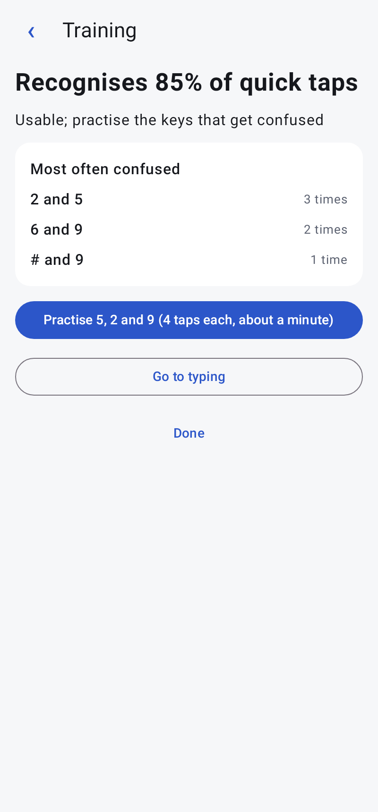
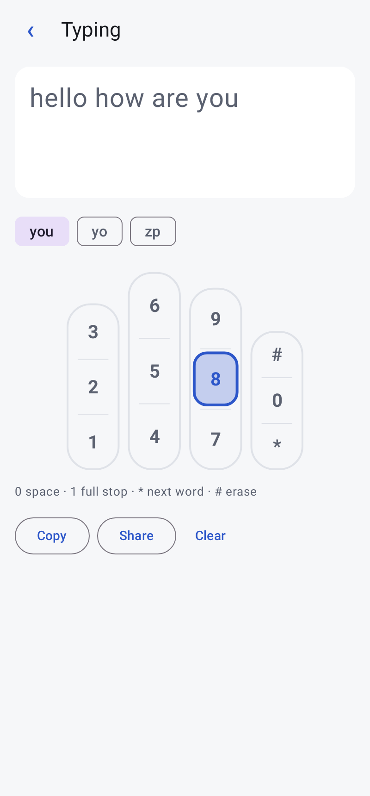

# Telehaptic

Wearable eyes-free text input. The thumb touches the 12 phalanges of the other four fingers, laid out like a phone keypad. A neodymium magnet on the thumbnail is seen by two magnetometers on the back of the hand. All computing happens in the Android app.

Palm side, fingers pointing right:

- **Finger = row:** index 1 2 3, middle 4 5 6, ring 7 8 9, little * 0 #.
- **Phalanx = column**, from the palm to the tip, so the keys sit as on a phone keypad.
- **Letters** as on phone keys (T9). 1 = full stop, 0 = space, * = next word, # = erase.
- **N:** the magnet on the thumbnail.
- **S1, S2 (dashed):** the two magnetometers on the back of the hand, behind the knuckles of the index and little fingers. The bar is the distance between them that the app asks for.

The difference of the two sensors' readings largely cancels the uniform Earth field, which shifted key centres by about 13 µT on the earlier single-sensor phone stand. The sensors sit behind the knuckles rather than on the wrist because the magnet's field falls with the cube of the distance: about 20–40 mm from the thumbnail there versus 100 mm or more from a fingertip touch to the wrist.

| Folder | Contents |
|---|---|
| `firmware/telehaptic/` | capsule firmware: Seeed XIAO nRF52840 Sense, core "Seeed nRF52 Boards" |
| `android/` | app: capsule link, training, typing with T9, experiments, diagnostics |
| `analysis/` | analysis of recordings: `python analysis/analyze.py data` → `report/report.md` |
| `data/` | recordings |
| `docs/protocol.md` | BLE service, packets, commands |
| `docs/build-day.md` | build day checklist |
| `docs/screens/` | app screens with example data |
| `tools/make_fake_data.py` | synthetic recordings to test the analysis |

## Hardware

- Seeed XIAO nRF52840 Sense: BLE, on-board IMU LSM6DS3TR-C, LiPo charging.
- TCA9548A I2C multiplexer at 0x70.
- GY-271 modules with QMC5883P (0x2C); QMC5883L (0x0D) also supported. Channel 0: sensor 1 (index side), channel 1: sensor 2 (little finger side), channel 2: spare.
- Grove vibration motor on D2.
- LiPo 3.7 V 320 mAh with a switch.

## Downloads

Every push is built by GitHub Actions. The result is in the release [latest](https://github.com/ivan-kalachikov/telehaptic/releases/tag/latest).

**Firmware `telehaptic.uf2`:**
1. Connect the XIAO with a USB-C data cable.
2. Double-tap the reset button quickly. The `XIAO-SENSE` drive appears.
3. Copy the file onto it.

The board restarts by itself with the new firmware.

**App `telehaptic.apk`:** open the release page on the phone, download the file and install it. A new build installs over the old one; the model and the recordings are kept.

Without the app: open the XIAO USB port in any serial terminal at 115200. It prints the bus scan, then a `LIVE` line twice a second with each sensor's field in µT.

## App screenshots

Rendered by a Robolectric test with example data: `gradle testDebugUnitTest -Pscreenshots` in `android/`.

| | | | |
|---|---|---|---|
|  |  |  |  |
